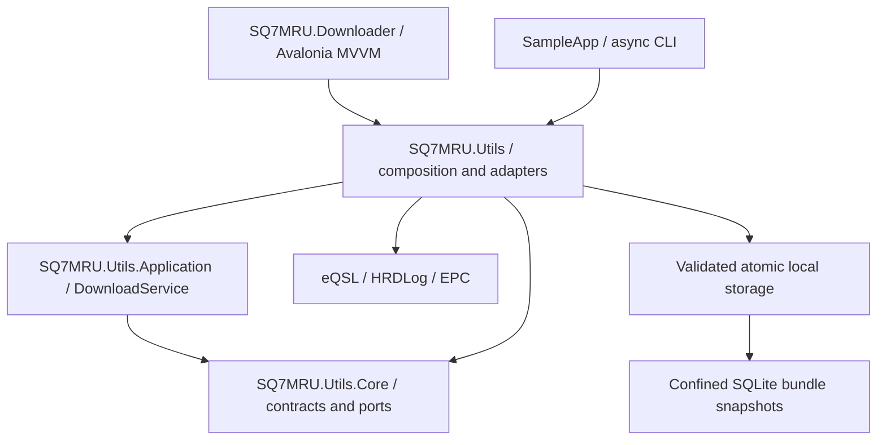

# OpenSpec baseline

This is an as-built specification of the current source tree, established on 2026-10-25 with OpenSpec 1.15.0. It describes existing behavior rather than proposing a new implementation.

## Capabilities

| Capability | Scope |
| --- | --- |
| [Library architecture](specs/library-architecture/spec.md) | Project boundaries, public API, DI and options |
| [Download workflow](specs/download-workflow/spec.md) | Streaming discovery, concurrency, cancellation, partial results |
| [Service integrations](specs/service-integrations/spec.md) | eQSL login/accounts/upload, HRDLog and EPC |
| [HTTP resilience](specs/http-resilience/spec.md) | Cookies, redirects, retries, timeouts and service pacing |
| [Artifact security](specs/artifact-security/spec.md) | Confinement, image/PDF and ZIP validation, SQLite bundle index |
| [ADIF processing](specs/adif-processing/spec.md) | Parsing, normalization and export |
| [Desktop experience](specs/desktop-experience/spec.md) | English UI, account selection and live newest-first results |
| [Delivery](specs/delivery/spec.md) | CI, NuGet publishing, desktop releases and repository hygiene |

Each capability includes requirements, WHEN/THEN scenarios, implementation paths and verification references. A verification reference identifies related coverage; it does not claim every scenario has a dedicated automated test.

## Working with the baseline

Use the installed OpenSpec CLI from the repository root:

```sh
openspec list --specs
openspec show download-workflow --type spec
openspec validate --all --strict --no-interactive
```

For a future behavior change, create a change with `openspec new change <change-name>`, prepare the schema artifacts and spec deltas, implement and test the change, then archive it using the CLI. There is no active change proposal for this baseline: the code already exists.

## Architecture



The physical NuGet package embeds the Core and Application assemblies. Projects are separated to enforce dependency direction, not to require consumers to install three internal packages. The desktop uses its own composition root. Per-account HTTP sessions own their cookies; the provider-wide scheduler shares service cooldowns and eQSL card-generation reservations.

EPC discovers categories within the certificate accordion and stores images, PDFs and unpacked ZIP certificates in each group directory. One SQLite database below the selected output root indexes complete bundles. See the [EPC behavior guide](../docs/epc-downloads.md) for output layout, resume semantics, logical progress counts and migration from JSON indexes. See [release notes](../docs/release-notes.md) for the changes from the legacy implementation.

## Current limits

- External service pages can change. Integration fixtures are synthetic and do not prove live-account compatibility.
- Native secure-storage behavior was verified locally on Windows; Unix behavior is covered by the Linux/macOS CI matrix and must pass there before release. No successful remote CI run is asserted by this baseline.
- ADIF content validation in the store checks markers and rejects HTML; the reader performs record-level validation separately. ADIF parsing is synchronous CPU work with cancellation checks.
- Discovery and fetch are bounded in flight, but final results, deduplication keys and adapter resource maps still grow with the number of discovered items.
- Discovery failure finishes earlier work and reports `[discovery]`; it does not resume the failed iterator or discover later items.
- EPC converts individual category request failures to per-category results and continues later categories; failed initial login or authentication rejection while fetching a certificate remains fatal.
- EPC skips valid local certificates and complete indexed bundles. Remote additions inside an unchanged completed bundle are not detected automatically.
- The certificate menu uses a stable membership entry point (`item-133`, with the membership article URL as a fallback); category IDs and translated labels are not enumerated in a fixed list. Ambiguous multi-selector certificate forms are reported rather than guessed.
- PDFs receive bounded structural checks, without rendering or active-content sanitization. SQLite operations run synchronously on a worker thread; database snapshots use asynchronous file reads/writes with native synchronous confinement checks and an interprocess lock.
- Cancellation throws and preserves committed files; it does not return a final `DownloadResult`.
- Cookies and credentials are memory-only. The legacy eQSL inbox export still carries a password in an HTTPS query; additional instrumentation must redact it.
- A skipped PNG/GIF/PDF may be reported under the original logical JPG item name, although its existing on-disk format is detected. EPC bundle counters represent selections, not extracted certificate counts.
- Desktop uploads, persistent credential storage, installers, code signing, notarization and automatic application updates are not implemented. DMC is intentionally absent.
- The UI language is English; there is no language selector or localization catalog.

For public repository handling and ignore rules, see [repository hygiene](../docs/repository-hygiene.md).

## Validation snapshot

The local Release validation on 2026-10-25 passed 98 tests and a solution build without warnings. An isolated consumer installed the generated NuGet package and exercised its public API, including native SQLite-backed ZIP storage. All eight OpenSpec capabilities passed strict validation. These results describe local Windows checks; cross-platform GitHub Actions runs are configured separately and are not asserted here.

The baseline includes EPC PDF certificates, flat extraction of multi-certificate ZIPs, migration from JSON indexes to SQLite, and skipping valid existing certificates and complete indexed bundles. Real account exports, certificates, credentials and private filesystem paths are excluded from documentation examples and versioned fixtures.
